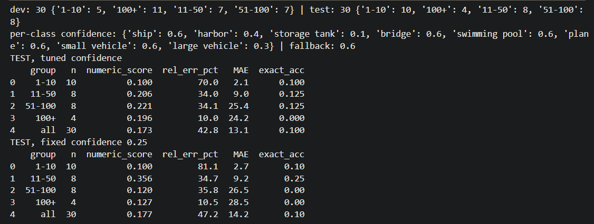

# Benchmarks: why the engine is tiled YOLO26-OBB

All numbers come from `docs/results/` (raw CSVs) and were produced before building the app.

## Setup
- **Data:** DOTA-v1.0 validation images cut into 2048x2048 windows.
- **Counting set:** 60 (window, class) pairs, 15 per density band (1-10, 11-50, 51-100, 100+ objects).
  Ground truth counts objects whose centre lies inside the window.
- **Metric:** mean absolute error (MAE) in objects per window. Exact-match accuracy is below 0.15 for every method on the 11+ bands, so MAE is the more useful number.
- **Caveat:** n = 15 per band, one run, no confidence intervals. Treat gaps under ~20% as noise.

## Counting MAE by density (lower is better)

| Method | 1-10 | 11-50 | 51-100 | 100+ | sec/img (GPU, Kaggle) |
|---|---|---|---|---|---|
| YOLO26n-OBB, full image | 1.6 | 5.7 | **16.7** | 86.0 | 0.02 |
| **YOLO26n-OBB, tiled 1024, 20% overlap** | 1.5 | **5.1** | 20.7 | **41.2** | 0.13-1.6 |
| SAM 3, untiled, thr 0.5 | 2.0 | 8.5 | 15.0 | 195.7 | 2-4 |
| SAM 3, tiled 1024, ov 0.2, thr 0.3 | 6.7 | 12.3 | 49.1 | 130.5 | 5-7 |
| Qwen3-VL-4B, plain prompt | 1.5 | 10.7 | 34.1 | 174.5 | 1.6-1.8 |
| EarthDial-4B | **1.3** | 9.3 | 39.1 | 147.0 | 1.6 |

Overall MAE over all 60 pairs: YOLO full 27.5, **YOLO tiled 17.1**, SAM 3 untiled 53.4.

## Findings
1. Tiled YOLO is best at 11-50 and by a wide margin at 100+ (41.2 vs 86.0 for the full image and 130-196 for SAM 3 / VLMs). It is competitive at 1-10 and behind full-image YOLO and untiled SAM 3 at 51-100.
2. VLMs and SAM 3 need a GPU and take 1.5-7 s per window. They did not beat YOLO on dense scenes, so they are not in the deployed app.
3. Per-class confidence tuning (YOLO26-x, 30-window dev/test split) lowered test MAE from 14.2 to 13.1. That is a small gain on a small split. The thresholds are in `app/engine.py` and are specific to those weights.

## Known failure cases
- Very dense small objects: storage tanks, true 428, tiled 293; ships, true 477 (one window) overcounted by tiling in some runs.
- `P0060_1451_205`, small vehicles, true 72, predicted 0 by both full and tiled passes.
- Small vehicles in dense parking lots are over-counted (true 110, predicted 201).
- Tiling can over-count at tile borders; rotated NMS (IoU 0.3, IoS 0.7) reduces but does not remove this.

## Not part of the product
Grounding (VRSBench referring expressions) and measurement (box geometry x GSD) were evaluated too. The grounding rows that use an "oracle" pick the best box with ground truth, so they are ceilings, not real accuracy. Measurement error was 4.8% (length, n=8) and 17.7% (area, n=10), with many missed matches, so the app only reports lengths and only when the user supplies a GSD. See `results_sheet.csv` for every row.
